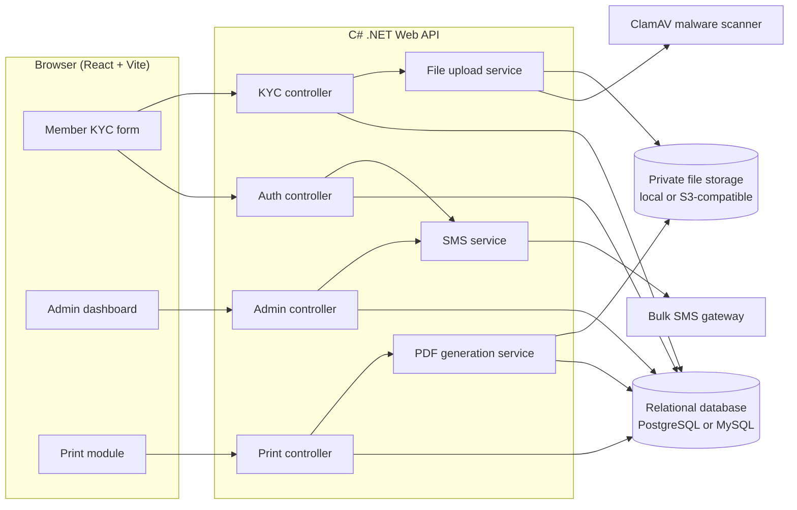
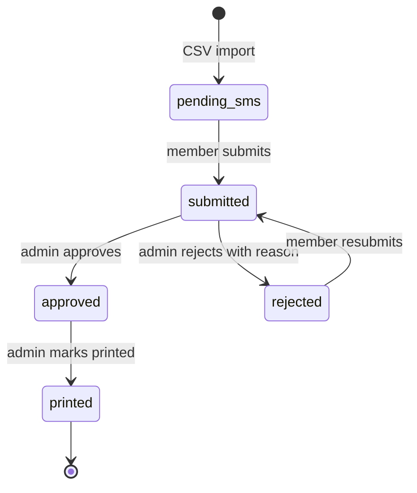
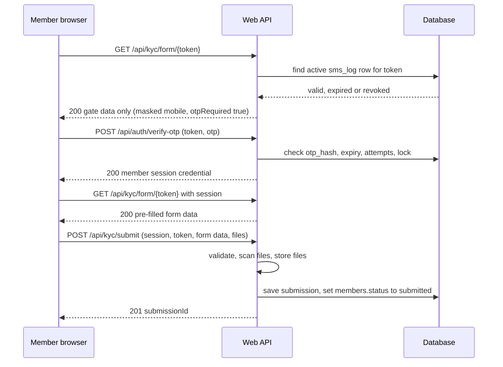
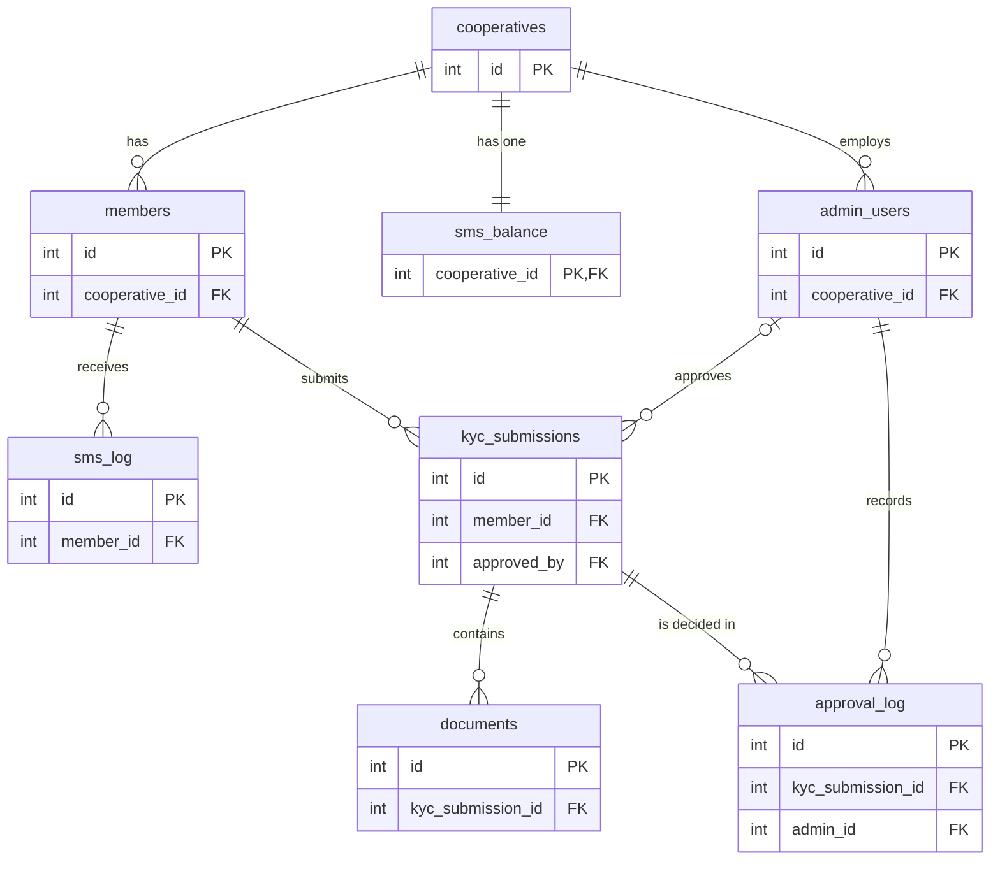
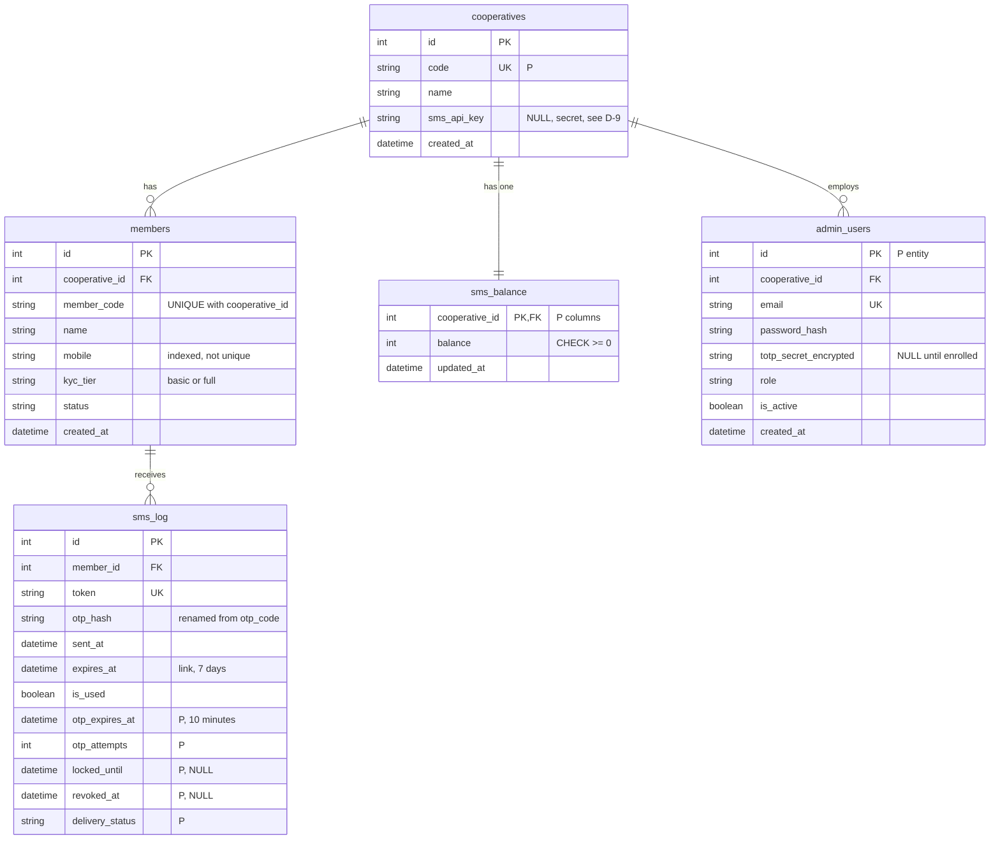
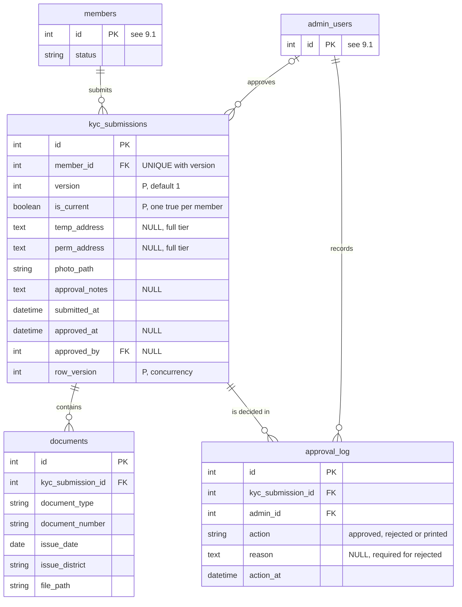

# kyc-verification-and-approval-system

# Cooperative Member KYC Automation Platform: Phase 1 Specification

| | |
|---|---|
| Phase | 1 - Core KYC collection and approval |
| Document version | 1.1 (corrected draft for project-owner review) |
| Reference source | `doc-kyc-collection.pdf` (v1.0, April 2026) |
| Stack | React + Vite (frontend), C# .NET Web API with Entity Framework Core (backend), relational database, SMS gateway, private file storage, PDF generation |
| Companion file | `KYC_Phase1_Audit_Report.md` (audit findings, include/exclude list, open questions, verification report) |

## How to read this document

Every statement that goes beyond a plain restatement of the reference PDF carries one of these labels.

| Label | Meaning |
|---|---|
| **[Confirmed]** | Stated in the reference PDF. |
| **[Resolved]** | The sources contradict each other or are ambiguous. This document applies the stated rule. Decision ID points to Section 17. |
| **[Proposed]** | Not in the source. Needed to make a confirmed requirement implementable. Needs owner approval. |
| **[Optional]** | Not needed for Phase 1. |
| **[Open]** | Decision pending. A default is stated. |

Unlabelled text restates confirmed requirements.

---

## 1. Project Overview

### 1.1 Problem

Cooperatives need to collect KYC from 500+ member organizations (about 50,000 members). Four problems exist today: manual data entry errors, duplicate submissions, low completion rates through untrusted SMS links, and no offline fallback for members without smartphones.

### 1.2 Solution

A web-based KYC collection system in which:

- cooperatives send personalized SMS links that carry an OTP;
- members open pre-filled forms on their smartphones;
- an admin dashboard supports review and bulk approval;
- a print-ready PDF is generated for each approved submission.

---

## 2. Objectives and Scope

### 2.1 Objectives

1. Import cooperative members from CSV.
2. Send personalized invitation SMS messages with a unique link token and an OTP.
3. Let members verify their identity and complete a pre-filled KYC form (Basic or Full tier) with photo and identity documents.
4. Let admins review, approve (single or bulk) or reject with a reason, and let rejected members resubmit.
5. Generate a printable PDF for approved submissions and record that it was printed.
6. Support manual KYC entry by staff for members without smartphones.

### 2.2 Phase 1 scope [Confirmed]

| Included | Excluded |
|---|---|
| SMS-based OTP login | WhatsApp bot integration |
| Web form with document upload | Mobile app |
| Admin approval dashboard | Payment collection |
| PDF generation and printing | Multi-language support |
| Basic KYC tiers (Basic and Full) | Advanced ID verification (OCR) |
| Manual offline entry by staff | Automated SMS reminders |

Notes on scope:

- "Automated SMS reminders" are excluded. The dashboard's manual **Send SMS Reminder** button is a separate, confirmed feature (admin-triggered).
- The PDF overview mentions "bulk approval/rejection" but defines only a bulk **approve** endpoint. This document includes bulk approve only **[Resolved D-10]**.
- "Manual offline entry by staff" is in the scope table, but the PDF defines no screen, endpoint or table for it. The mechanism is **[Open D-6]**.

---

## 3. User Roles and Permissions

| Role | Authentication | Allowed actions | Data boundary |
|---|---|---|---|
| Member | SMS link token plus OTP, then a short-lived member session **[Resolved D-2]** | Open own pre-filled form, verify OTP, submit KYC, resubmit after rejection | Only the member record bound to the token |
| Cooperative admin | Password plus TOTP second factor; JWT with Admin role | Import members, send SMS, review, approve, reject, print, mark printed | Only the admin's own cooperative **[Resolved D-5]** |
| Cooperative system client | API key | Read members and SMS balance (read-only) | Only the cooperative the key belongs to |
| Staff entering KYC offline | Not defined in the source | Enter KYC for members without smartphones | **[Open D-6]** |

Cooperative isolation rule **[Resolved D-5]**: the cooperative of every admin or API-key request is taken from the authenticated principal (`admin_users.cooperative_id` or the API key's cooperative). A `cooperativeId` sent by the client is never trusted. If it is accepted at all, it must equal the principal's cooperative. A multi-cooperative or platform-wide admin role is not defined in the source and is not part of this specification.

---

## 4. System Architecture

### 4.1 High-level architecture



### 4.2 Responsibilities

| Component | Responsibility |
|---|---|
| Frontend (React + Vite) | Member form (mobile-first), admin dashboard, print module. Frontend validation is convenience only; the backend repeats every check. |
| Auth controller | OTP verification and member session issue; OTP re-request **[Proposed]**; admin login and 2FA |
| KYC controller | Pre-filled form data, submission |
| Admin controller | Member import, bulk SMS, pending list, approve, bulk approve, reject |
| Print controller | PDF generation, mark as printed |
| SMS service | Provider-agnostic SMS sending (abstracted for multiple providers) |
| File upload service | Multipart upload, validation, malware scan, storage |
| PDF generation service | Builds the PDF from saved database data using PuppeteerSharp or IronPDF |
| Database | All relational data (Section 7) |
| Private file storage | Photos and documents; never publicly readable |

### 4.3 Technology and infrastructure

| Item | Status |
|---|---|
| React + Vite, TypeScript, React Router | **[Confirmed]** |
| C# .NET Web API, Entity Framework Core, code-first migrations | **[Confirmed]** |
| Relational database | **[Confirmed]** that one is needed. PostgreSQL and MySQL are both named in the source. They stay alternatives until the owner confirms **[Open D-3]**. The source's schema script task names PostgreSQL 14+, which is this document's default. |
| SMS gateway, private file storage (local or S3-compatible), PDF library (PuppeteerSharp or IronPDF) | **[Confirmed]** |
| ClamAV | **[Confirmed]** as the scanner. Hosting is not defined, so it must be deployed with the API **[Proposed]**. |
| Hangfire background job queue | Named once in the risk table as a mitigation. Needed only if bulk actions exceed their time target **[Optional]**. |
| Redis, second API instance, load balancer, CDN, API gateway | **[Optional]**. Named in the deployment sketch, not required for Phase 1 functionality. A shared store becomes necessary for rate limits only if more than one API instance runs. |

---

## 5. End-to-End Workflow

### 5.1 Steps

| Step | Actor | Action | Result |
|---|---|---|---|
| 1 | Admin | Uploads member CSV (`POST /api/admin/members/upload`) | Members stored with `members.status = pending_sms` |
| 2 | Admin | Triggers bulk SMS (`POST /api/admin/sms/send-bulk`) | Balance checked; unique token and OTP created per member in `sms_log`; SMS sent; balance reduced |
| 3 | Member | Opens the link | Token validated; only a limited gate view is returned **[Resolved D-2]** |
| 4 | Member | Verifies OTP (`POST /api/auth/verify-otp`) | Member session issued; pre-filled form returned |
| 5 | Member | Completes form, uploads photo and documents, submits (`POST /api/kyc/submit`) | Files scanned and stored; `members.status = submitted` |
| 6 | Admin | Reviews pending list (`GET /api/admin/kyc/pending`) | None |
| 7a | Admin | Approves (single or bulk) | `members.status = approved`; `approval_log` row; approval SMS |
| 7b | Admin | Rejects with a reason | `members.status = rejected`; `approval_log` row; rejection SMS with a new link |
| 8 | Member | Resubmits after rejection | New submission version; `members.status = submitted` |
| 9 | Admin | Requests PDF (`GET /api/admin/print/{submissionId}`) | PDF built from saved data |
| 10 | Admin | Marks printed (`POST /api/admin/print/mark-done`) | `members.status = printed`; `approval_log` row |

### 5.2 Edge cases

| Situation | Behaviour |
|---|---|
| Link older than 7 days | `KYC010`. The UI shows "Link expired, request new". Staff re-send via the reminder action, which issues a new token **[Resolved D-12]**. |
| OTP older than 10 minutes | `KYC001`. The member requests a new OTP via `POST /api/auth/request-otp` **[Proposed]**, subject to the rate limit. |
| Wrong OTP 3 times | Lock for 15 minutes; `KYC006` |
| Duplicate submission | `KYC003` when `members.status` is not `pending_sms` or `rejected`. Concurrent duplicate requests are resolved by the database constraint on the current submission (Section 7.4). |
| Repeated approve or reject | `KYC009` **[Proposed]**; no change. In bulk approval the record is listed in `failedIds`. |
| SMS gateway failure | `KYC008`. `sms_log.delivery_status = failed`; member stays `pending_sms`; the balance is not charged for failed sends **[Open D-8]**. |
| Rejected record | Member uses the rejection SMS link; the form returns the previous data and the rejection reason in `existingSubmission`; resubmission creates a new version **[Resolved D-1]**. |
| Admin tries another cooperative's record | `404 KYC002`; no data returned |

---

## 6. KYC Status and Authentication Flow

### 6.1 Canonical status model **[Resolved]**

The source uses `submitted` in the flow and database discussion but returns `pending_review` from the submit API. This document uses one value set everywhere.

Canonical database values are stored in `members.status`. The source indexes `members (cooperative_id, status)` for "pending approvals", which confirms the status column lives on `members`.

| Database value | API value | UI label |
|---|---|---|
| `pending_sms` | `pending_sms` | Awaiting invitation |
| `submitted` | `submitted` (replaces the source's `pending_review`) | Pending review |
| `approved` | `approved` | Approved |
| `rejected` | `rejected` | Needs correction |
| `printed` | `printed` | Printed |



| From | To | Trigger | Actor | Backend check |
|---|---|---|---|---|
| (none) | `pending_sms` | CSV import | Admin | Row valid, cooperative from principal |
| `pending_sms` | `submitted` | Submit | Member | Valid member session; validation passed |
| `submitted` | `approved` | Approve or bulk approve | Admin | Status is `submitted`; same cooperative |
| `submitted` | `rejected` | Reject | Admin | Status is `submitted`; reason present |
| `rejected` | `submitted` | Resubmit | Member | Valid member session on a new token |
| `approved` | `printed` | Mark done | Admin | Status is `approved` |

Every other transition is rejected with `KYC009` **[Proposed code]**. Each transition runs in one database transaction with an optimistic concurrency check.

### 6.2 Token and OTP rules

| Rule | Value | Source |
|---|---|---|
| Link token lifetime | 7 days (`sms_log.expires_at`) | Confirmed |
| OTP lifetime | 10 minutes (`sms_log.otp_expires_at`) | Confirmed lifetime; the extra column is **[Proposed]** because one `expires_at` cannot hold both lifetimes |
| OTP length | 6 digits | Confirmed |
| OTP requests | 5 per mobile number per hour | Confirmed |
| Wrong OTP attempts | 3, then 15-minute lock (`KYC006`) | Confirmed in test TC-07 only; this document also makes it a security rule |
| OTP storage | Hash only (`otp_hash`); never plaintext | **[Proposed]**; the source column `otp_code` is renamed |
| OTP reuse | A verified OTP cannot be used again | **[Proposed]** |
| Older tokens | A new token for a member revokes all earlier tokens (`revoked_at`) | **[Resolved D-12]** |
| Active token | The newest `sms_log` row for the member with `revoked_at` empty, `is_used = false` and `expires_at` in the future | **[Resolved]** |
| `is_used` | Set to true when a submission is saved with the token | **[Resolved]** (the source does not define it) |

### 6.3 Member authentication sequence **[Resolved D-2]**

The source contradicts itself. The data-flow diagram shows token "auto-login" with no OTP step. The form specification, state diagram and security rules require an OTP. `GET /api/kyc/form/{token}` is documented as "Auth: None" yet returns the member's name, mobile and code. This document requires the OTP and returns protected data only after verification.



Security note: the OTP travels in the same SMS as the link, so it proves possession of the SMS, not a second independent factor. It still stops a forwarded or leaked link from working after 10 minutes. This limitation is accepted by the source design.

### 6.4 Admin authentication

1. Admin enters email and password; the password is verified against an adaptive hash.
2. Admin enters a TOTP code from an authenticator app.
3. The API issues a JWT valid for 8 hours and a refresh token valid for 7 days **[Confirmed]**.
4. Every admin endpoint requires the JWT with the Admin role.

Refresh-token storage, rotation and revocation, and TOTP enrolment and recovery, are not specified **[Open D-18]**.

---

## 7. Database Design

### 7.1 Conventions

- Table names are lowercase snake_case: `cooperatives`, `admin_users`, `sms_balance`, `members`, `sms_log`, `kyc_submissions`, `documents`, `approval_log`. The source mixes uppercase singular entity names (`MEMBER`) with the index table names (`kyc_submission`); this document uses the plural forms above everywhere.
- Types are generic. Mapping: `int` identity integer; `string(n)` varchar; `datetime` is stored in UTC (`timestamptz` on PostgreSQL); `date`; `text`; `boolean`.
- Every column is NOT NULL unless marked NULL.
- Source column: `PDF`. Source column renamed: `PDF, renamed`. Addition: `Proposed`.

### 7.2 Authoritative schema

| Table | Column | Type | Null | Key and constraint | Source |
|---|---|---|---|---|---|
| cooperatives | id | int | no | PK | PDF |
| cooperatives | code | string(30) | no | UNIQUE | Proposed (needed by the PDF file-name pattern) |
| cooperatives | name | string(200) | no | | PDF |
| cooperatives | sms_api_key | string(255) | yes | secret, see D-9 | PDF |
| cooperatives | created_at | datetime | no | | PDF |
| admin_users | id | int | no | PK | Proposed (entity) |
| admin_users | cooperative_id | int | no | FK to cooperatives.id | Proposed |
| admin_users | email | string(255) | no | UNIQUE | Proposed |
| admin_users | password_hash | string(255) | no | adaptive hash | Proposed |
| admin_users | totp_secret_encrypted | string(255) | yes | NULL until enrolled | Proposed |
| admin_users | role | string(20) | no | CHECK in ('admin') | Proposed |
| admin_users | is_active | boolean | no | default true | Proposed |
| admin_users | created_at | datetime | no | | Proposed |
| sms_balance | cooperative_id | int | no | PK and FK to cooperatives.id (one-to-one) | Proposed (entity named in PDF, no columns) |
| sms_balance | balance | int | no | CHECK >= 0 | Proposed |
| sms_balance | updated_at | datetime | no | | Proposed |
| members | id | int | no | PK | PDF |
| members | cooperative_id | int | no | FK to cooperatives.id | PDF |
| members | member_code | string(50) | no | UNIQUE with cooperative_id | PDF column, Proposed constraint |
| members | name | string(200) | no | | PDF |
| members | mobile | string(20) | no | indexed, not unique | PDF |
| members | kyc_tier | string(10) | no | CHECK in ('basic','full') | PDF |
| members | status | string(20) | no | CHECK in ('pending_sms','submitted','approved','rejected','printed'), default 'pending_sms' | PDF |
| members | created_at | datetime | no | | PDF |
| sms_log | id | int | no | PK | PDF |
| sms_log | member_id | int | no | FK to members.id | PDF |
| sms_log | token | string(64) | no | UNIQUE | PDF |
| sms_log | otp_hash | string(64) | no | hash of the OTP | PDF, renamed from otp_code |
| sms_log | sent_at | datetime | no | time the send was attempted | PDF |
| sms_log | expires_at | datetime | no | link expiry (7 days) | PDF |
| sms_log | is_used | boolean | no | default false | PDF |
| sms_log | otp_expires_at | datetime | no | OTP expiry (10 minutes) | Proposed |
| sms_log | otp_attempts | int | no | default 0 | Proposed |
| sms_log | locked_until | datetime | yes | | Proposed |
| sms_log | revoked_at | datetime | yes | | Proposed |
| sms_log | delivery_status | string(10) | no | CHECK in ('queued','sent','failed'), default 'queued' | Proposed |
| kyc_submissions | id | int | no | PK | PDF |
| kyc_submissions | member_id | int | no | FK to members.id | PDF |
| kyc_submissions | version | int | no | UNIQUE with member_id, default 1 | Proposed (D-1) |
| kyc_submissions | is_current | boolean | no | at most one true per member | Proposed (D-1) |
| kyc_submissions | temp_address | text | yes | required for the full tier | PDF |
| kyc_submissions | perm_address | text | yes | required for the full tier | PDF |
| kyc_submissions | photo_path | string(500) | no | | PDF |
| kyc_submissions | approval_notes | text | yes | duplicates approval_log.reason | PDF |
| kyc_submissions | submitted_at | datetime | no | | PDF |
| kyc_submissions | approved_at | datetime | yes | | PDF |
| kyc_submissions | approved_by | int | yes | FK to admin_users.id | PDF (target table was missing) |
| kyc_submissions | row_version | int | no | optimistic concurrency, default 0 | Proposed |
| documents | id | int | no | PK | PDF |
| documents | kyc_submission_id | int | no | FK to kyc_submissions.id | PDF |
| documents | document_type | string(50) | no | | PDF |
| documents | document_number | string(100) | no | | PDF |
| documents | issue_date | date | no | | PDF |
| documents | issue_district | string(100) | no | | PDF |
| documents | file_path | string(500) | no | | PDF |
| approval_log | id | int | no | PK | PDF |
| approval_log | kyc_submission_id | int | no | FK to kyc_submissions.id | PDF |
| approval_log | admin_id | int | no | FK to admin_users.id | PDF (target table was missing) |
| approval_log | action | string(20) | no | CHECK in ('approved','rejected','printed') | PDF column, Proposed value list |
| approval_log | reason | text | yes | required when action is 'rejected' | PDF |
| approval_log | action_at | datetime | no | | PDF |

### 7.3 Relationships and delete rules

| Parent | Child | Cardinality | Delete rule |
|---|---|---|---|
| cooperatives | members | one-to-many | RESTRICT |
| cooperatives | sms_balance | one-to-one | RESTRICT |
| cooperatives | admin_users | one-to-many | RESTRICT |
| members | sms_log | one-to-many | RESTRICT (see D-13 for cleanup) |
| members | kyc_submissions | one-to-many (one current) | RESTRICT |
| kyc_submissions | documents | one-to-many | RESTRICT |
| kyc_submissions | approval_log | one-to-many | RESTRICT |
| admin_users | approval_log | one-to-many | RESTRICT |
| admin_users | kyc_submissions (`approved_by`) | one-to-many | RESTRICT |

No ordinary application operation deletes `members`, `kyc_submissions`, `documents` or `approval_log` rows. **[Proposed]** The application's database account should not hold DELETE rights on these four tables. The only deletion allowed is retention cleanup of expired `sms_log` rows, if the owner approves it (D-13).

### 7.4 Constraints and indexes

| Index or constraint | Purpose | Source |
|---|---|---|
| `members (cooperative_id, status)` | Filter pending approvals per cooperative | PDF |
| `members (mobile)` | Find an existing member | PDF |
| `sms_log (token)` UNIQUE | Fast token and OTP validation | PDF |
| `sms_log (expires_at)` | Clean up expired tokens | PDF |
| `kyc_submissions (submitted_at)` | Date-range reporting | PDF (source wrote `kyc_submission`) |
| `members (cooperative_id, member_code)` UNIQUE | Member code unique per cooperative | Proposed |
| `sms_log (member_id, sent_at)` | Find a member's newest token | Proposed |
| `kyc_submissions (member_id, version)` UNIQUE | Version numbering | Proposed |
| `kyc_submissions (member_id)` UNIQUE WHERE `is_current` | One current submission per member; blocks concurrent duplicates | Proposed. MySQL has no partial indexes, so use a generated column or a locking check there. |
| `documents (kyc_submission_id)` | Load a submission's documents | Proposed |
| `approval_log (kyc_submission_id, action_at)` | Load a submission's history | Proposed |
| `admin_users (email)` UNIQUE | Login lookup | Proposed |

### 7.4a Design decisions

**A. Member uniqueness.** `member_code` is unique inside one cooperative. Mobile numbers are indexed but not unique: the source states no uniqueness rule, and family members may legitimately share a number. The CSV import warns on duplicate mobile numbers instead of rejecting them **[Open D-4]**.

**B. SMS balance.** Each cooperative has exactly one balance row (`sms_balance.cooperative_id` is both PK and FK). Bulk send runs in one transaction: it reserves the needed amount with `UPDATE sms_balance SET balance = balance - n WHERE cooperative_id = ? AND balance >= n`. If the update affects no row, the send stops with `KYC013` **[Proposed]**. Units, top-up and refund of failed sends are **[Open D-8]**. All `sms_balance` columns are proposed because the source names the entity without columns.

**C. SMS logs and authentication.** Section 6.2 defines the active token, the two lifetimes, revocation and reuse rules. A new token issue (reminder, rejection) revokes the member's earlier tokens. `otp_attempts` and `locked_until` implement the 3-attempt, 15-minute lock.

**D. Resubmission.** The source says one submission per member and also allows rejected members to resubmit. Two designs fit:

| | Reuse one row | New version per resubmission (selected) |
|---|---|---|
| Source constraint `UNIQUE(member_id)` | Kept as is | Replaced by a partial unique index on the current row, **explicitly changing the source** |
| Rejected data and files | Overwritten, unless every field and file is versioned separately | Kept: each version owns its documents |
| Audit trail | Log rows point to a row whose content later changes | Log rows point to the exact content that was decided on |
| Complexity | Lowest | Slightly higher |

**Recommendation [Open D-1]:** the new-version design, because approval and rejection history is only meaningful if the reviewed content stays unchanged. If the owner keeps the source constraint, use the first design and add version fields to `documents` so that old files are never overwritten. Until the owner answers, this specification uses the new-version design and says so openly.

**E. Approval history.** `approval_log` records every admin decision (approved, rejected, printed) with the admin, reason and time. A resubmission is recorded by its own `kyc_submissions` row (`version`, `submitted_at`). Printing is recorded by an `approval_log` row plus `members.status = printed`. This covers the confirmed audit requirement ("all admin actions logged to the `approval_log` table") for review actions. Other admin actions (login, CSV import, bulk SMS) are not covered. A separate audit table is recommended only if the owner wants them logged **[Open D-14]**.

**F. Foreign keys and deletion.** See Section 7.3. The source's `approved_by` and `admin_id` columns pointed at a table the source never defined; `admin_users` fixes that.

---

## 8. ER Diagram

Generated from the schema in Section 7.2. Columns show keys only; full columns are in Section 9. All cooperatives data is isolated through `cooperatives`.



---

## 9. Detailed Schema

Convention: every column is NOT NULL unless its comment says NULL. `[P]` marks a proposed addition. Lengths and CHECK lists are in Section 7.2.

### 9.1 Cooperatives, administrators, members and SMS



### 9.2 KYC submissions, documents and approval history


---

## 10. Security Requirements

Labels: **Required** = confirmed in the source. **Recommended** = this document's addition. Nothing below is claimed as implemented; it is a requirement list.

| Area | Requirement | Label |
|---|---|---|
| Admin password | Stored as an adaptive hash (never plaintext) | Recommended (source gives no storage rule) |
| Admin 2FA | TOTP code after the password. One secret per admin, stored encrypted in `admin_users.totp_secret_encrypted`. The source's single `ADMIN_2FA_SECRET` variable cannot serve several admins; it may only be an encryption key (see D-18) | Required (2FA); Resolved (per-admin secret) |
| JWT | Expires after 8 hours; Admin role middleware on every admin endpoint | Required |
| Refresh token | Valid 7 days. Storage, rotation, revocation: not defined | Required; Open D-18 |
| Member access | Token (7 days) plus OTP (10 minutes) before any protected data is returned; member session short-lived | Required; Resolved D-2 |
| OTP handling | 6 digits, hash storage, single use, 3 attempts then 15-minute lock | Required (lifetimes, lock); Recommended (hash) |
| Rate limiting | 5 OTP requests per mobile number per hour; middleware on public endpoints | Required |
| Cooperative isolation | Cooperative taken from the authenticated principal; every query filtered by it; cross-cooperative IDs return 404 | Required (cooperative-specific access); Resolved D-5 |
| API key (cooperative endpoints) | Keys stored hashed; read-only scope | Required (API key); Recommended (hashing) |
| File upload | JPG, PNG (photo); JPG, PNG, PDF (documents); max 5 MB per file; ClamAV scan; infected files rejected and not stored; if the scanner is unavailable the upload fails (fail closed) | Required (type, size, scan); Recommended (fail closed) |
| Private storage | Files never served by URL directly; access only through authorized API calls. The source's `photoUrl` and `fileUrl` examples must therefore be short-lived authorized links | Required (private); Resolved |
| SQL injection | Entity Framework parameterized queries only | Required |
| XSS | React escaping and a Content-Security-Policy header | Required |
| CORS | Only the frontend origin (development and production) | Required |
| Secrets | Environment variables or a secrets manager; never in source control or documentation. Per-cooperative `sms_api_key` in the database must be encrypted or replaced by a platform key | Required (env vars); Open D-9 |
| Errors | Safe messages with `KYC` codes; no stack traces or internal details | Required |
| Audit logging | Every admin approval action recorded in `approval_log` | Required; broader scope Open D-14 |

---

## 11. API Documentation

### 11.1 Conventions

- JSON over HTTPS. Timestamps are ISO 8601 in UTC.
- Success: `{"success": true, "data": {...}}`. Lists add `"pagination": {"page", "limit", "total"}`.
- Error: `{"success": false, "error": {"code": "KYC001", "message": "..."}}` **[Resolved]**. The source mixes flat and nested shapes (for example the submit response puts `submissionId` at the top level). One envelope is used throughout.
- Admin endpoints take their cooperative from the JWT, not from the request **[Resolved D-5]**.

### 11.2 Endpoints

| Method | Route | Auth | Purpose | Label |
|---|---|---|---|---|
| GET | `/api/kyc/form/{token}` | None for the gate view; member session for full data | Gate view, then pre-filled form | Confirmed route; auth Resolved D-2 |
| POST | `/api/auth/request-otp` | Token | Send a new OTP | Proposed (the 5 per hour limit and 10-minute OTP need it) |
| POST | `/api/auth/verify-otp` | Token and OTP | Verify OTP, issue member session | Confirmed route; response Proposed |
| POST | `/api/kyc/submit` | Member session | Submit or resubmit KYC | Confirmed route; auth Resolved D-2 |
| GET | `/api/coop/members` | API key | List the cooperative's members | Confirmed; response shape Open |
| GET | `/api/coop/sms-balance` | API key | Read the SMS balance | Confirmed; response shape Proposed |
| POST | `/api/admin/members/upload` | JWT Admin | Import member CSV | Confirmed; CSV columns Open |
| POST | `/api/admin/sms/send-bulk` | JWT Admin | Send invitation or reminder SMS | Confirmed; request shape Open |
| GET | `/api/admin/members` | JWT Admin | Member table and CSV export for the dashboard | Proposed (the dashboard tab needs a JWT-protected list) |
| GET | `/api/admin/kyc/pending` | JWT Admin | Paged pending list | Confirmed |
| POST | `/api/admin/kyc/approve` | JWT Admin | Approve one submission | Confirmed route; body Proposed |
| POST | `/api/admin/kyc/bulk-approve` | JWT Admin | Approve many | Confirmed (listed only in the detail section of the source) |
| POST | `/api/admin/kyc/reject` | JWT Admin | Reject with reason | Confirmed route; body Proposed |
| GET | `/api/admin/print/{submissionId}` | JWT Admin | Generate PDF (`application/pdf`) | Confirmed |
| POST | `/api/admin/print/mark-done` | JWT Admin | Mark as printed | Confirmed route; body Proposed |

### 11.3 Request and response details

**GET `/api/kyc/form/{token}`**

Without a member session (gate view), returns no personal data beyond a masked mobile number:

```json
{ "success": true, "data": { "otpRequired": true, "otpSentTo": "98******78" } }
```

With a member session (after OTP), returns the source's fields:

```json
{
  "success": true,
  "data": {
    "memberId": 1001,
    "memberCode": "COOP001-001",
    "name": "Ram Sharma",
    "mobile": "9812345678",
    "kycTier": "full",
    "existingSubmission": null,
    "otpRequired": false,
    "otpSentTo": "98******78"
  }
}
```

`existingSubmission` is null for a first submission. After a rejection it holds the previous values and the rejection reason. Errors: `KYC010` (token invalid, expired or revoked).

**POST `/api/auth/request-otp`** [Proposed]. Body `{ "token": "..." }`. Returns 202. Errors: `KYC006` (rate limit or lock), `KYC008` (SMS gateway), `KYC010`.

**POST `/api/auth/verify-otp`**. Body `{ "token": "...", "otp": "123456" }`. Returns 200 with `{ "data": { "sessionToken": "...", "expiresInSeconds": N } }` [Proposed shape]. Errors: `KYC001`, `KYC006`, `KYC010`. Session lifetime is **[Open D-15]**.

**POST `/api/kyc/submit`** (`multipart/form-data`, header `Authorization: Bearer <member session>`)

| Field | Type | Required | Notes |
|---|---|---|---|
| token | string | Yes | From the SMS link; must match the session |
| tempAddress | string | Full tier | Minimum 5 characters |
| permAddress | string | Full tier | Minimum 5 characters |
| photo | file | Yes | JPG or PNG, max 5 MB |
| documents[] | file[] | Yes | At least one; JPG, PNG or PDF; max 5 MB each |
| documentTypes[] | string[] | Yes | One per file, same order |
| documentNumbers[] | string[] | Yes | One per file |
| issueDates[] | date[] | Yes | `YYYY-MM-DD` |
| issueDistricts[] | string[] | Yes | One per file |

The source also lists `otp` as a required body field and also says "OTP in header". With a verified member session the OTP is not sent again **[Resolved D-2]**. A stateless alternative (OTP sent with the submit request) is documented in D-2.

Success: `201` with `{ "success": true, "data": { "submissionId": 5001, "status": "submitted" } }`. The source's `pending_review` is replaced by `submitted` (Section 6.1). Errors: `KYC003`, `KYC004`, `KYC005`, `KYC011`, `KYC012`.

**GET `/api/admin/kyc/pending`**. Query `page`, `limit`. The source also has `cooperativeId`; it is ignored or must equal the principal's cooperative. Response lists `submissionId`, `memberId`, `memberCode`, `name`, `photoUrl` (short-lived authorized link), `submittedAt`, and `documents[]` (`type`, `number`, `issueDate`, `district`, `fileUrl`), plus `pagination`.

**POST `/api/admin/kyc/approve`** [body Proposed]: `{ "submissionId": 5001 }`. Returns `{ "data": { "submissionId": 5001, "status": "approved" } }`. Errors: `KYC002`, `KYC009`.

**POST `/api/admin/kyc/bulk-approve`**: `{ "submissionIds": [5001, 5002, 5003] }`. The source body also carries `cooperativeId`; it is validated, not trusted. Returns `{ "success": true, "data": { "approvedCount": 3, "failedIds": [] } }`. A record that is not `submitted`, or belongs to another cooperative, goes into `failedIds`. A per-item reason list is a proposed extension. Bulk reject is not part of Phase 1 (D-10).

**POST `/api/admin/kyc/reject`** [body Proposed]: `{ "submissionId": 5001, "reason": "..." }`. The reason is required (minimum length **[Open]**). Sends a rejection SMS with a new token. Errors: `KYC002`, `KYC009`, `KYC012`.

**GET `/api/admin/print/{submissionId}`**: returns `application/pdf` built from saved data. Allowed for `approved` (first print) and `printed` (reprint) **[Open D-11]**. Other states: `KYC009`.

**POST `/api/admin/print/mark-done`** [body Proposed]: `{ "submissionId": 5001 }`. `approved` to `printed`. Errors: `KYC002`, `KYC009`.

**POST `/api/admin/sms/send-bulk`** [request Open]: a list of `memberIds` and a template (`invitation` or `reminder`). Checks the balance, issues tokens and OTPs, sends, reduces the balance. Response lists queued and failed members. Errors: `KYC008`, `KYC013`.

**POST `/api/admin/members/upload`** [CSV columns Open; default `member_code`, `name`, `mobile`, `kyc_tier`]: returns counts of imported and rejected rows and per-row errors. Errors: `KYC012`.

### 11.4 Error codes

| Code | HTTP | Trigger | Label |
|---|---|---|---|
| KYC001 | 400 | OTP wrong, expired or already used | Confirmed |
| KYC002 | 404 | Submission not found or outside the caller's cooperative | Confirmed |
| KYC003 | 409 | Member already has a submission that is not open for resubmission | Confirmed |
| KYC004 | 413 | File larger than 5 MB | Confirmed |
| KYC005 | 415 | File type not JPG, PNG or PDF | Confirmed |
| KYC006 | 429 | OTP rate limit exceeded or member locked for 15 minutes | Confirmed |
| KYC007 | 403 | Admin role or API key missing or insufficient | Confirmed |
| KYC008 | 503 | SMS gateway timeout or failure | Confirmed |
| KYC009 | 409 | Illegal status transition (for example approving an approved record) | Proposed |
| KYC010 | 410 | Token invalid, expired or revoked | Proposed (the source shows only the UI message) |
| KYC011 | 422 | Malware detected in an upload | Proposed (the source requires rejection, gives no code) |
| KYC012 | 422 | Validation failed (missing field, bad format, missing document) | Proposed |
| KYC013 | 409 | SMS balance too low for the send | Proposed |

A missing or invalid JWT returns standard `401`.

---

## 12. Frontend Requirements

**Routes** [Confirmed]: `/kyc/:token` (member form), `/login`, `/admin`. The source's SMS templates link to `https://kyc.coop/{token}` without `/kyc/`. The link in every SMS must match the route **[Resolved]**: use `https://kyc.coop/kyc/{token}` or add a redirect.

**Member form** [Confirmed]

| Section | Fields | Validation |
|---|---|---|
| Header | Cooperative logo, member name | none |
| OTP step | 6-digit input with auto-tab and auto-verify | Numeric, 6 characters |
| Personal information | Name (pre-filled, read-only), mobile (pre-filled) | none |
| Address | Temporary and permanent address, Full tier only | Minimum 5 characters |
| Photo | Camera or gallery | JPG or PNG, under 5 MB |
| Documents | Dynamic list: type, number, issue date, district, file | At least one document |
| Submit | Submit button and confirmation modal | All required fields |

The Basic tier's field list is not defined in the source (**D-7**). Images are compressed in the browser before upload.

**Admin dashboard** [Confirmed]: sidebar and three tabs.

- **Pending Approvals:** card grid (3 per row desktop, 1 mobile); each card shows photo thumbnail, name, member code, submission date; expandable document preview; approve and reject per card; bulk checkbox and "Approve Selected"; filters by date range (and cooperative only if D-5 changes).
- **Print Queue:** approved records with member name, code, approval date, "Print PDF" button, and a "Mark as Printed" control.
- **Member Management:** table of member code, name, mobile, KYC status; "Send SMS Reminder" for pending members; "Import CSV"; "Export to CSV" (uses `GET /api/admin/members` [Proposed]).

**Libraries** (source choices, not requirements): TanStack Query for API data and React Context for authentication state are well justified. Zustand for modal and selection state and Formik with Yup for forms are implementation choices that the team may replace with simpler equivalents **[Optional]**.

**Responsive layout** [Confirmed]: under 640 px one column with bottom-sheet modals; 640 to 1024 px two columns; over 1024 px three columns with side-by-side preview. Components: toast notifications, confirmation modal, loading spinner, error boundaries.

---

## 13. Deployment and Configuration

### 13.1 Mandatory and optional infrastructure

| Item | Phase 1 |
|---|---|
| .NET API host, relational database, private file storage, SMS gateway, ClamAV service, HTTPS, static hosting for the frontend | Mandatory |
| Docker Compose for local development (API, database), Dockerfile for the API | Deliverable |
| CDN, API gateway, second API instance with load balancer, managed Redis | Optional |
| Netlify or Vercel, DigitalOcean Spaces, Application Insights | Examples in the source; hosting and monitoring products are open (note the mix of vendors) |

### 13.2 Environment variables

Names only. Never commit values.

| Variable | Purpose |
|---|---|
| `DB_CONNECTION_STRING` | Database connection |
| `JWT_SECRET` | JWT signing key (32 or more random characters) |
| `SMS_API_KEY` | SMS provider key (see D-9) |
| `SMS_SENDER_ID` | Registered sender name |
| `STORAGE_ACCESS_KEY`, `STORAGE_SECRET_KEY`, `STORAGE_BUCKET_NAME` | S3-compatible storage |
| `FRONTEND_URL` | Allowed CORS origin |
| `ADMIN_2FA_SECRET` | Source name. Not a valid per-admin secret (see Section 10); treat as an encryption key at most |
| `OTP_HASH_KEY` | Key used to hash OTPs [Proposed] |
| `CLAMAV_HOST`, `CLAMAV_PORT` | Malware scanner location [Proposed] |

### 13.3 Capacity assumptions (targets, not measurements)

| Item | Value |
|---|---|
| Expected members | 50,000 |
| Peak concurrent form submissions | about 100 |
| Concurrent admin users | 50 |
| File storage | about 50 GB (1 MB per member). Likely low: a photo and several documents of up to 5 MB each can exceed 1 MB |
| SMS volume | 50,000 initial plus 10,000 reminders |
| API response target | under 500 ms |
| Uptime target | 99.5% |

---

## 14. Testing Strategy

### 14.1 Targets

| Type | Target | Tools |
|---|---|---|
| Backend unit tests | 80% coverage | xUnit, Moq |
| Frontend unit tests | 70% coverage | Vitest, React Testing Library |
| Integration tests | Key APIs | Postman or Newman |
| End-to-end tests | Submit, approve, print | Playwright |

These are goals. No claim of achieved coverage or performance is made without test evidence.

### 14.2 Test cases

| ID | Scenario | Expected result | Source |
|---|---|---|---|
| TC-01 | Member opens a link that is 8 days old | `KYC010`; UI shows "Link expired, request new" | Confirmed |
| TC-02 | Submit without a required document | `KYC012`; field highlighted | Confirmed |
| TC-03 | Admin approves one submission | `members.status = approved`; `approval_log` row | Confirmed |
| TC-04 | Admin bulk approves 50 submissions | All 50 approved; response under 3 seconds | Confirmed |
| TC-05 | Duplicate submission for the same member | `KYC003`; "Already submitted, pending approval" | Confirmed |
| TC-06 | Upload a file over 5 MB | `KYC004` | Confirmed |
| TC-07 | Enter a wrong OTP 3 times | `KYC006`; locked 15 minutes | Confirmed |
| TC-08 | Generate PDF for an approved record | Valid PDF with all data and a QR code | Confirmed |
| TC-09 | Complete valid submission | 201; files stored; documents saved; `submitted` | Proposed |
| TC-10 | Wrong OTP once | `KYC001`; attempt counted | Proposed |
| TC-11 | Expired OTP, then request a new one | `KYC001`, then new OTP works | Proposed |
| TC-12 | Upload an unsupported format | `KYC005` | Proposed |
| TC-13 | Upload a malware test file | `KYC011`; nothing stored | Proposed |
| TC-14 | Reject with a reason; reject without one | `rejected` with log row; second case `KYC012` | Proposed |
| TC-15 | Resubmit after rejection | New version; old documents kept; `submitted` | Proposed |
| TC-16 | Call an admin endpoint without or with a non-admin token | 401 or `KYC007` | Proposed |
| TC-17 | Admin of cooperative A requests a record of cooperative B (and bulk-approves it) | `KYC002`; bulk item in `failedIds`; no data leaked | Proposed |
| TC-18 | Approve an already approved record | `KYC009`; no change | Proposed |
| TC-19 | Request PDF for a non-approved record | `KYC009` | Proposed |
| TC-20 | Mark approved record as printed | `printed`; `approval_log` row | Proposed |
| TC-21 | SMS gateway fails during bulk send | `KYC008`; member stays `pending_sms`; `delivery_status = failed` | Proposed |
| TC-22 | Call form endpoint with a valid token but no session | Gate view only; no name or code | Proposed |
| TC-23 | Use an older token after a new one was issued | `KYC010` | Proposed |
| TC-24 | Two simultaneous submissions for the same member | Exactly one succeeds; other gets `KYC003` | Proposed |

### 14.3 Load-test targets

| Scenario | Users | Duration | Pass target |
|---|---|---|---|
| Form submission | 100 | 5 min | 95% of requests under 2 s |
| Admin pending list | 50 | 5 min | 95% under 500 ms |
| Bulk approve (50 IDs) | 20 | 2 min | Response under 3 s |

---

## 15. Monitoring and Audit Logging

| Level | Use |
|---|---|
| Error | API exceptions, database failures, SMS send failures |
| Warn | Rate limit hit, more than 3 invalid OTP attempts, upload malware detected |
| Info | KYC submitted, admin approved or rejected, PDF generated |
| Debug (development only) | SQL queries, request and response bodies. Must never log OTPs, tokens, passwords or uploaded content |

| Metric | Source | Alert target |
|---|---|---|
| SMS delivery rate | Gateway callback | below 95% |
| Form completion rate | submitted divided by invitations sent | below 60% |
| Average approval time | `approved_at` minus `submitted_at` | above 48 hours |
| Upload failure rate | API error logs | above 5% |
| API response time (p95) | Application monitoring | above 2 seconds |

Audit logging: Phase 1 records admin review actions in `approval_log`. Logging of logins, imports, SMS sends and failed 2FA is **[Open D-14]**.

---

## 16. Phase 1 Deliverables

Source checklist, unchecked until built and tested.

- [ ] **Backend:** project structure (Controllers, Services, Repositories, Models); EF Core migrations; JWT and admin role middleware; OTP service; SMS service (multi-provider abstraction); file upload service with virus-scan hook; bulk SMS endpoint; bulk approve and reject handling; PDF service; rate limiting; request and response logging; `/health` endpoint
- [ ] **Frontend:** Vite and TypeScript project; routes `/kyc/:token`, `/admin`, `/login`; mobile-first KYC form; OTP input; file upload with preview and compression; admin layout; pending grid; bulk bar; print queue; CSV upload; toasts; loading states and error boundaries
- [ ] **Database:** schema script (PostgreSQL 14+ default); seed data for one test cooperative (development only); code-first migration strategy
- [ ] **DevOps:** Dockerfile; Docker Compose; CI that runs tests; deployment guide
- [ ] **Documentation:** Postman collection; admin manual (PDF, 10 pages maximum); SMS template library; staff troubleshooting guide

Required by this specification but absent from the source checklist: `request-otp` endpoint; `admin_users` with TOTP enrolment; ClamAV service in Docker Compose; rate-limit store; offline-entry mechanism (pending D-6); `GET /api/admin/members`.

---

## 17. Known Limitations and Open Decisions

Details, options and reasoning are in the companion file.

| ID | Decision | Default used in this document |
|---|---|---|
| D-1 | Resubmission storage | New version per resubmission (changes the source `UNIQUE(member_id)`) |
| D-2 | Member authentication sequence | OTP before any protected data; short-lived member session |
| D-3 | Database engine | PostgreSQL 14+ |
| D-4 | Mobile number uniqueness | Not unique; warn on import |
| D-5 | Admin role and cooperative scope | One cooperative per admin; cooperative from the principal |
| D-6 | Manual offline entry mechanism | Undefined. Proposed: staff enter data through an admin screen |
| D-7 | Basic versus Full tier fields | Full adds addresses; Basic otherwise undefined |
| D-8 | SMS balance units, top-up, refunds | Count of SMS; no charge for failed sends |
| D-9 | `sms_api_key` per cooperative | Encrypt, or use one platform key |
| D-10 | Bulk reject | Not in Phase 1 |
| D-11 | Printing, QR content, reprint | Browser print of the server PDF; QR content undefined; reprint allowed |
| D-12 | Token reissue | New token on reminder and rejection; older tokens revoked |
| D-13 | Retention and cleanup of `sms_log` and files | Delete expired `sms_log` rows only |
| D-14 | Audit scope beyond `approval_log` | Not in Phase 1 |
| D-15 | Member session lifetime | Short; value to be set |
| D-16 | Accepted document types per tier | Undefined |
| D-17 | Scanner outage behaviour | Fail closed |
| D-18 | Refresh tokens and 2FA enrolment or recovery | Undefined |

---

## 18. Future Phases

Not part of Phase 1. Timelines are the source's estimates.

| Phase | Features | Estimate |
|---|---|---|
| 2 | WhatsApp bot integration, automated reminders, offline tablet app | 2 weeks |
| 3 | OCR for ID verification, face matching, digital signature | 3 weeks |
| 4 | Dashboard analytics, Excel export, API for a cooperative's MIS | 2 weeks |

---

## Appendix A: SMS Templates

Variables: `{MemberName}`, `{CoopName}`, `{token}`, `{otp}`, `{reason}`. The link in each template must follow the route in Section 12.

| ID | Use | Text |
|---|---|---|
| A.1 | Invitation | `{MemberName}, {CoopName} requests KYC update. Link: https://kyc.coop/kyc/{token} OTP: {otp} (auto-verifies) Free. Valid 7 days.` |
| A.2 | Reminder (sent manually by an admin) | `Reminder: {MemberName}, complete KYC for {CoopName}. Link: https://kyc.coop/kyc/{token} Expires in 2 days.` |
| A.3 | Approval | `{MemberName}, your KYC for {CoopName} is APPROVED. Visit office with ID to collect printed copy. Thank you.` |
| A.4 | Rejection | `{MemberName}, your KYC for {CoopName} needs correction. Reason: {reason} Please resubmit: https://kyc.coop/kyc/{token}` |

The A.2 text "Expires in 2 days" assumes a reminder on day 5 of the same token. If every reminder issues a new token (D-12), the text must state the new expiry.

## Appendix B: File Naming

| Item | Pattern | Example |
|---|---|---|
| Uploaded file | `{cooperativeId}/{memberId}/{documentType}_{timestamp}.{extension}` | `1/1001/national_id_20260410143022.jpg` |
| Printed PDF | `KYC_{cooperativeCode}_{memberCode}_{approvalDate}.pdf` | `KYC_COOP001_001_20260410.pdf` |

Uploaded files are stored under server-generated names inside private storage. `{cooperativeCode}` needs the proposed `cooperatives.code` column. A resubmission adds a version folder or suffix so earlier files are not overwritten (D-1).

## Appendix C: Source Traceability

| README section | Reference PDF section |
|---|---|
| 1 to 2 | 1 Executive Summary |
| 4 | 2.1 High-Level Architecture, 7.1 Infrastructure |
| 5 | 2.2 and 2.3 Data Flow |
| 6 | 6.1 Authentication Flows, 3 and 4 |
| 7 to 9 | 3 Database Schema |
| 10 | 6.2 Security Rules |
| 11 | 4 API Specifications, Appendix C |
| 12 | 5 Frontend Architecture |
| 13 | 7.2 and 7.3 |
| 14 | 8 Testing Strategy |
| 15 | 9 Monitoring and Logging |
| 16 | 11 Deliverables Checklist |
| 18 | 12 Next Steps, 10 Assumptions and Risks (for D-items) |

Documentation end of Phase 1 specification.